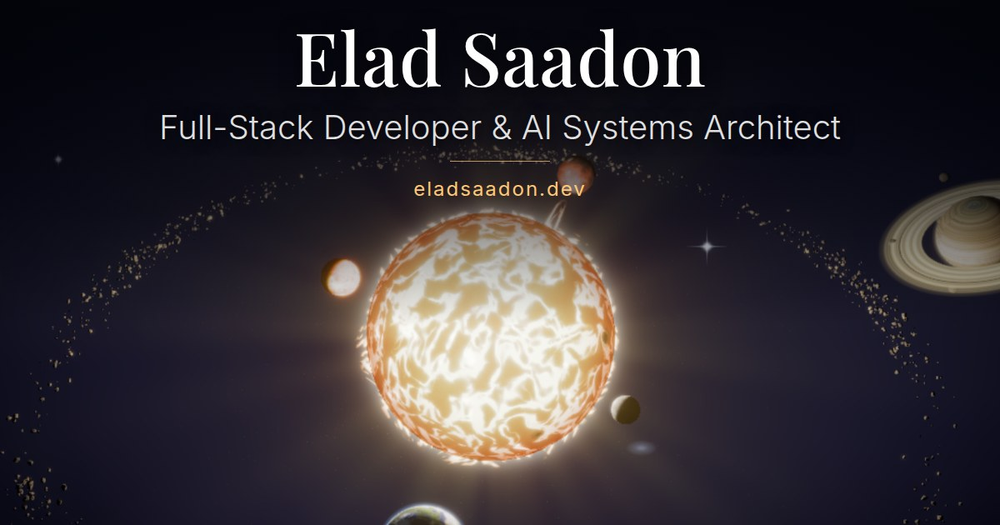

# eladsaadon.dev - a portfolio you scroll into

[](https://www.eladsaadon.dev)

**[Open the site](https://www.eladsaadon.dev)** - scroll from a whole galaxy down to one planet. Every planet is a page: about, projects, services, tech, contact.

The portfolio of Elad Saadon (אלעד סעדון), a full-stack developer and AI systems architect from Israel. It runs in three languages - English, Hebrew (right to left) and Russian.

## What is in here

- **A galaxy in WebGL** - React Three Fiber, drei and postprocessing, with hand-written GLSL shaders for the galaxy (`src/components/scene/galaxy/shaders.ts`).
- **Scroll as a camera** - scrolling carries the camera from the galaxy down to a planet, a drag turns the view, and on phones a swipe steps between stops (`src/components/scene/CameraRig.tsx`, `DragControls.tsx`).
- **Three languages, one layout** - `/`, `/he` and `/ru`, with the layout mirrored for Hebrew.
- **Search and AI readable** - per-language metadata and share images, JSON-LD, a sitemap, `llms.txt` and `llms-full.txt`.
- **An accessibility widget** - text size, contrast and grayscale (`src/components/AccessibilityWidget.tsx`).

## Tech Stack

- Next.js (App Router), React, TypeScript
- three.js, React Three Fiber, drei, postprocessing, GLSL
- Tailwind CSS, Framer Motion, Zustand
- Neon (serverless Postgres), Vercel Analytics and Speed Insights

## Featured Projects

- OpenClaw - autonomous AI system (multi-node)
- Netanya Emergency Teams - municipal emergency management platform
- Political Compass IL - civic-tech analytics platform
- AI Visual Web Scraper - desktop AI data collection tool
- SHAPERZ - community marketing platform
- [Loomvale](https://github.com/Bobikobi/GAME) - free pixel-art browser game built by its players ([play](https://loomvale.vercel.app))
- [Claude Stats Widget](https://github.com/Bobikobi/claude-stats-widget) - desktop widget for Claude Code usage (Linux and Windows)

## Contact

- Website: https://www.eladsaadon.dev
- Email: eladeladsaa@gmail.com
- LinkedIn: https://www.linkedin.com/in/elad-saadon-184809281/
- GitHub: https://github.com/Bobikobi

## Development

Run locally:

```bash
pnpm install
pnpm dev
```

## Public Safety

This repository uses a public safety guard to reduce accidental secret leakage.

Run before pushing:

```bash
pnpm repo:guard
```

Policy and rollout guidance for all repositories:

- [PUBLIC_REPO_POLICY.md](PUBLIC_REPO_POLICY.md)
- [.env.example](.env.example)
